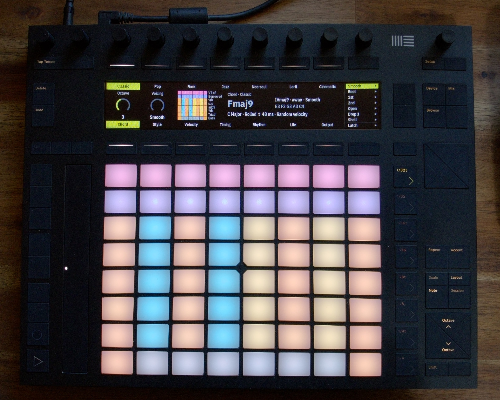

# Pushtoo

**Full documentation:** <https://tucktuckg00se.github.io/Pushtoo/>

Pushtoo turns an Ableton Push 2 on Linux into an instrument for any synth, DAW or hardware rig: plug in Push, pick the **Pushtoo Out** port, and play. Scales stay in key, every chord pad sounds good, the touch strip strums, and the screen shows what your hands are doing.


*The chord grid: the screen shows Fmaj9, the pad map and the voicing buttons.*

Pushtoo is for *playing*. If you want deep control of a DAW from the Push (tracks, devices, clips, mixer), use [DrivenByMoss](https://mossgrabers.de) for Bitwig or Reaper instead; the two can't share the Push at the same time.

## Status

Beta (0.1.0b3). Testers welcome: see [Beta testing](https://tucktuckg00se.github.io/Pushtoo/beta-testing/).

- **Works:** Keyboard, Drums and the chord grid; note repeat, the arpeggiator and MIDI clock; Knobs and Mix; Life and standby; YAML profiles with a browser editor; themes.
- **Next:** loops (a step sequencer and a MIDI looper).

See [docs/PRD.md](docs/PRD.md) for the product spec.

## Install

You need a Push 2 (with its power supply plugged in) and Linux: Arch, Debian, Ubuntu, Raspberry Pi OS or Fedora. One command:

```sh
curl -fsSL https://raw.githubusercontent.com/tucktuckg00se/Pushtoo/main/install.sh | sh
```

The installer **asks before every step** and changes nothing until you confirm. It can also start Pushtoo in the background at login, so plugging in the Push is all it takes. For what each step does, the options, upgrading and uninstalling, see [Installation](https://tucktuckg00se.github.io/Pushtoo/installation/).

## Quick start

1. Plug in Push 2. If you didn't set up the background service, run `pushtoo`.
2. In your DAW or synth, choose the MIDI input **Pushtoo Out** (under PipeWire: `Midi-Bridge:Pushtoo: Out (capture)`).
3. Play the pads. Pushtoo starts in C minor on MIDI channel 1. Tap **Layout** for Drums and the chord grid.

Next: [Getting started](https://tucktuckg00se.github.io/Pushtoo/getting-started/) and [Controls](https://tucktuckg00se.github.io/Pushtoo/controls-reference/). Something not working? Run `pushtoo doctor`, or see [Troubleshooting](https://tucktuckg00se.github.io/Pushtoo/troubleshooting/).

## Development

```sh
uv sync
uv run pytest
uv run pushtoo -v
```

Requires Python 3.12+, [uv](https://docs.astral.sh/uv/), and the cairo, ALSA and libusb development packages. For every command, the hardware gates and the project layout, see [Development](https://tucktuckg00se.github.io/Pushtoo/development/).

## Credits

Pushtoo is a fork of [Pysha](https://github.com/ffont/pysha) by Frederic Font and uses a fork of his [push2-python](https://github.com/ffont/push2-python). Both are MIT licensed; Pysha's MIT notice is kept in [LICENSES/MIT-Pysha.txt](LICENSES/MIT-Pysha.txt).

## License

Pushtoo is free software under the [GNU General Public License, version 3](LICENSE) or (at your option) any later version. Versions up to commit `55fea34` were released under the MIT License.
